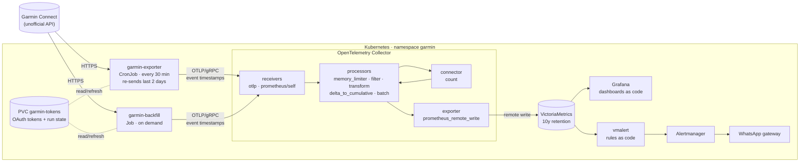

# Garmin Health Observability

My Garmin watch data in a real observability stack, running on Kubernetes. A Python exporter pulls Garmin Connect every 30 minutes and speaks **OTLP** to an **OpenTelemetry Collector**. The Collector writes to **VictoriaMetrics**, **Grafana** draws the dashboards, and **vmalert + Alertmanager** send alerts to WhatsApp.

The Collector is the centre of the design. Live data, backfilled history and the Collector's own telemetry all pass through one config that is version-controlled, tested and validated in CI.

## Screenshots

**Garmin Health**: sleep stages, HRV, resting heart rate, body battery, stress, steps, VO2 max.


**Garmin Pipeline**: the exporter and the OTel Collector watching themselves. Points received, refused, written and dropped, datapoints per metric from the count connector, queue depth, and Collector memory.


<sub>Regenerate with `make grafana` in one terminal and `make screenshots` in another ([`hack/screenshots.py`](hack/screenshots.py)).</sub>

## Architecture



- **One ingest path.** The CronJob and the backfill Job both send OTLP to the Collector. The exporter sets each datapoint's timestamp to the *event* time (midnight UTC for daily metrics), so history travels the same path as live data. Every write is idempotent, because re-sending a point overwrites it.
- **Bare series.** The Garmin series carry no `job`, `instance` or `otel_scope_*` labels. This is enforced on both sides: the exporter sends an empty OTLP resource, and the Collector disables scope labels and rejects label-changing processors. The [Collector doc](docs/otel-collector.md#from-otlp-datapoint-to-prometheus-series) explains why that matters.
- **No credentials in the cluster.** You log in once on your laptop (MFA included), and only the OAuth token file goes to a PVC. If Garmin ever rejects it, the run fails loudly and `GarminAuthFailing` fires.

## The OpenTelemetry Collector

The whole config is [`deploy/config/collector.yaml`](deploy/config/collector.yaml): three pipelines, one connector, one exporter.

| Pipeline | Receivers | Processors | Exporters |
|---|---|---|---|
| `metrics/garmin`: the health data | `otlp` | `memory_limiter` → `filter/garmin_only` → `batch` | `prometheus_remote_write` |
| `metrics/flow`: the same data, counted | `otlp` | `memory_limiter` → `filter/garmin_only` → `transform/metric_name` | `count` (connector) |
| `metrics/pipeline`: the pipeline itself | `count`, `prometheus/self` | `memory_limiter` → `delta_to_cumulative` → `batch` | `prometheus_remote_write` |

Extensions: `health_check` (kubelet probes), `zpages` (live pipeline graph), `pprof` (profiling).

What each part does:

- **`memory_limiter`** sheds load before an OOM kill. The exporter sees the refusal and re-sends on the next run.
- **`filter/garmin_only`** enforces the `garmin_*` naming contract at the edge.
- **The `count` connector** turns the flow of data into `garmin_pipeline_datapoints_total{metric_name}`. `GarminMetricStoppedArriving` uses it to notice when Garmin quietly changes a response shape.
- **The Collector scrapes its own telemetry**, so its health lives in the same VictoriaMetrics and Grafana as the data.

**→ [docs/otel-collector.md](docs/otel-collector.md)** covers every component in depth: why it is there, why it runs in that order, how an OTLP datapoint becomes a Prometheus series, what each failure costs, and how to debug and change the config safely.

## Quick start

Prerequisites: Docker Desktop, `minikube`, `kubectl`, and a Garmin Connect account.

```bash
git clone https://github.com/MartimBaltazar/garmin.git && cd garmin

# 1. Log in to Garmin once, on your machine (prompts for MFA if needed).
make install
printf 'GARMIN_EMAIL=you@example.com\nGARMIN_PASSWORD=...\n' > exporter/.env
make login                     # writes exporter/.tokens/garmin_tokens.json

# 2. Start minikube, build the image, deploy everything, upload the tokens.
make up

# 3. Pull history, then look at it.
make cluster-backfill FROM=2026-10-12
make grafana                   # http://localhost:3000 (admin / $GRAFANA_PASSWORD, default admin)
```

To get alerts on WhatsApp, message the [CallMeBot](https://www.callmebot.com/) WhatsApp number once to get an API key, then:

```bash
make whatsapp-secret PHONE=+351XXXXXXXXX APIKEY=XXXXXX
```

`.env` and `.tokens/` are git-ignored, and CI scans the history with gitleaks. Every `kubectl` call names `--context minikube`, so the Makefile can never touch another cluster.

## Daily operations

| Command | What it does |
|---|---|
| `make sync` | Run the exporter now (cached tokens, no MFA) |
| `make status` | Pods, CronJob, PVCs |
| `make logs` / `make collector-logs` | Tail the exporter / the Collector |
| `make query Q='garmin_daily_steps'` | Ask VictoriaMetrics directly |
| `make collector-debug` | Port-forward zpages (`/debug/pipelinez`) and the Collector's self-metrics |
| `make cluster-backfill FROM=… TO=…` | Replay history through the Collector |
| `make down` | Stop everything, **keep** metrics and tokens |
| `make nuke` | Delete the namespace and all data (asks first) |

## Alerts

[`deploy/config/alert-rules.yaml`](deploy/config/alert-rules.yaml), routed by severity in [`alertmanager.yaml`](deploy/config/alertmanager.yaml). Each alert has a runbook entry in [`docs/runbook.md`](docs/runbook.md).

| Group | Alerts |
|---|---|
| Exporter | `GarminExporterStale`, `GarminExporterSilent`, `GarminExporterFailing`, `GarminAuthFailing`, `GarminSourcesFailing`, `GarminSleepDataGap` |
| Collector | `OtelCollectorDown`, `OtelCollectorExportFailing`, `OtelCollectorRefusingData`, `GarminMetricStoppedArriving` |
| Health (info) | `GarminStepsBelowGoal`, `GarminRestingHeartRateElevated` |

Inhibition rules keep one root cause to one message. For example, `GarminAuthFailing` suppresses the "stale" and "data gap" alerts it causes. vmalert persists alert state to VictoriaMetrics, so a restart doesn't reset the `for:` timers.

## CI

[`.github/workflows/ci.yml`](.github/workflows/ci.yml) runs on every push:

- **exporter**: lockfile check, ruff, mypy, and pytest with coverage. There is no network access and no Garmin account; the tests run on a real captured payload.
- **configs**: each config is validated by the binary that will read it, at the deployed version. That means `otelcol validate`, `vmalert -dryRun`, `amtool check-config`, a check that generated dashboards are current, and a check that the Helm chart's config copies are identical.
- **manifests**: `kubectl kustomize`, `helm lint` and `helm template`, `kubeconform -strict` on both outputs, and a check that both render the same object kinds.
- **e2e**: the real Collector with the checked-in config, in front of a real VictoriaMetrics. It asserts on what was stored: no stray labels, event timestamps kept, both write paths converging on one series, the filter working, and the count connector and self-scrape producing data.
- **secrets**: gitleaks over the full history.
- **image**: multi-arch build (`amd64` + `arm64`) from `uv.lock` with hashes, pushed to GHCR on `v*` tags.

## Project layout

| Path | What |
|---|---|
| [`exporter/`](exporter/) | Python exporter: fetch → transform → OTLP ([README](exporter/README.md)) |
| [`deploy/`](deploy/) | Kubernetes manifests (kustomize). `deploy/config/` is the single source of truth for every config file |
| [`helm/`](helm/) | Helm chart rendering the same stack; `make chart-sync` copies `deploy/config/` into it |
| [`docs/otel-collector.md`](docs/otel-collector.md) | The Collector, component by component |
| [`docs/runbook.md`](docs/runbook.md) | What to do when each alert fires |
| [`dashboards/README.md`](dashboards/README.md) | Metric naming contract and dashboard design notes |
| [`hack/`](hack/) | Dashboard generator, screenshot script |
| [`PLAN.md`](PLAN.md) | Roadmap: k3s on Oracle, Terraform, Cloudflare |

## Stack

| Component | Version | Role |
|---|---|---|
| OpenTelemetry Collector (contrib) | 0.164.0 | Ingest, policy, self-telemetry |
| VictoriaMetrics | v1.155.0 | Storage, `-retentionPeriod=10y` |
| Grafana | 13.3.0 | Dashboards and datasource provisioned from files |
| vmalert + Alertmanager | v1.155.0 / v0.27.0 | Rules and routing as code |
| `garminconnect` | 0.3.x | Garmin Connect client (unofficial) |
