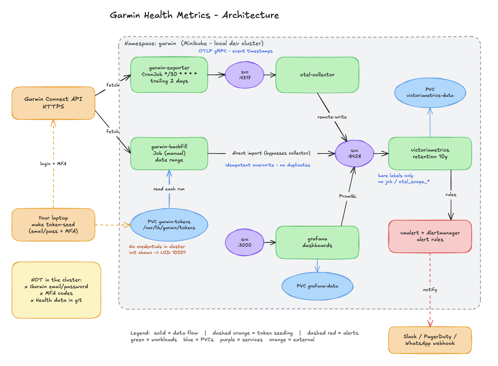

# Garmin Health Observability

Local minikube stack: VictoriaMetrics + OTel Collector + Grafana + Garmin exporter.
Exporter pulls Garmin Connect data every 30 minutes, writes to VictoriaMetrics,
Grafana dashboards read from it.

## Architecture



Backfill path: Job → Garmin API → exporter → VM import (direct, bypasses collector)
Tokens: your laptop → `make token-seed` → PVC `garmin-tokens` → exporter reads on every run
No credentials in cluster; `.env` and `.tokens/` are git-ignored.

## Prerequisites

- Docker Desktop running
- `minikube` installed
- `kubectl` configured to talk to minikube
- Garmin Connect email + password (MFA may be required once)

## One-command setup

```bash
git clone https://github.com/MartimBaltazar/garmin.git
cd garmin
make up
```

That starts minikube, builds and loads the exporter image, deploys the stack,
and opens Grafana at http://localhost:3000 (admin / admin).

## First time: log in to Garmin

The exporter needs your Garmin session tokens. Run:

```bash
echo "GARMIN_EMAIL=you@example.com" > exporter/.env
echo "GARMIN_PASSWORD=your_password" >> exporter/.env
make login
```

Follow the prompt for the MFA code. Tokens are saved to `exporter/.tokens/`
and uploaded to the cluster by `make up` automatically. Never commit `.env` or
`.tokens/` — both are git-ignored.

## Daily operations

```bash
# Force a sync right now (uses cached tokens, no MFA)
make sync

# Check what's running
make status

# Query VictoriaMetrics directly
make query Q='garmin_daily_steps'

# Tail exporter logs
make logs

# Open Grafana
make grafana   # http://localhost:3000, admin / admin
```

## Backfill history

Garmin's daily API serves roughly the last 4 weeks. To backfill:

```bash
make cluster-backfill FROM=2026-10-01 TO=2026-10-31
```

## Stop / restart

```bash
make down      # deletes the garmin namespace (data on PVCs is lost)
make up        # bring it back up
```

## Project layout

| Path | What |
|------|------|
| `exporter/` | Python exporter (fetch → transform → OTLP + VM import) |
| `deploy/` | Kubernetes manifests (kustomize) — the source of truth |
| `helm/` | Helm chart mirroring `deploy/` |
| `Makefile` | `up`, `sync`, `status`, `logs`, `grafana`, `query` |

## Stack

- VictoriaMetrics — time-series storage, 10y retention
- OTel Collector — pass-through, no label injection
- Grafana — dashboards (Garmin Health), admin / admin
- Exporter CronJob — every 30 minutes, bare-label OTLP export
