# The OpenTelemetry Collector

Every metric in this stack passes through one OpenTelemetry Collector:

- the 30-minute CronJob
- the backfill Job
- the Collector's own telemetry

The Collector does not interpret any of it. It accepts OTLP, protects itself, enforces the metric-name contract, counts what flows through, and writes Prometheus remote write to VictoriaMetrics. It also measures itself and writes those measurements to the same place.

This document explains the whole configuration: [`deploy/config/collector.yaml`](../deploy/config/collector.yaml). It covers what each component does, why it is there, and in what order. It also covers how an OTLP datapoint becomes a Prometheus series, what happens when something fails, and how to debug and change the config safely.

- [Why the Collector is the centre](#why-the-collector-is-the-centre)
- [The pipeline graph](#the-pipeline-graph)
- [What the exporter sends](#what-the-exporter-sends)
- [Receivers](#receivers)
- [Processors](#processors)
- [Connectors](#connectors)
- [Exporters](#exporters)
- [Extensions](#extensions)
- [The Collector's own telemetry](#the-collectors-own-telemetry)
- [From OTLP datapoint to Prometheus series](#from-otlp-datapoint-to-prometheus-series)
- [Failure modes](#failure-modes)
- [Debugging](#debugging)
- [Changing the config safely](#changing-the-config-safely)
- [Deliberately not used](#deliberately-not-used)

---

## Why the Collector is the centre

The exporter could write straight to VictoriaMetrics; the `GARMIN_EMIT=vm` escape hatch does exactly that. Routing everything through the Collector instead buys four things:

1. **One ingest point.** Live data and history arrive the same way, so there is one place to watch, one place to apply a rule, and one set of failure modes. Before this change, backfill skipped the Collector. That made the "two paths converge on one series" property something we hoped for rather than something guaranteed.
2. **Decoupling.** The exporter speaks OTLP, a vendor-neutral protocol. Swapping VictoriaMetrics for Prometheus, Mimir or a SaaS backend is an exporter change in one YAML file. The Python code stays the same.
3. **Policy at the edge.** The Collector enforces the `garmin_*` naming contract, sheds load before it runs out of memory, batches writes, and retries failed ones. None of that belongs in a Garmin client.
4. **Observability of the pipeline itself.** The Collector reports what it received, refused, sent and failed, per component, and counts datapoints per metric name. A dashboard and five alerts are built on that ([`dashboard-pipeline.json`](../deploy/config/dashboard-pipeline.json), `garmin_pipeline` group in [`alert-rules.yaml`](../deploy/config/alert-rules.yaml)).

## The pipeline graph

A Collector config declares components and then wires them into **pipelines** under `service.pipelines`. A component that is declared but not wired does nothing. Each pipeline is `receivers → processors (in order) → exporters`. A **connector** joins two pipelines: it is an exporter at the end of one and a receiver at the start of another.

```mermaid
flowchart LR
    subgraph sources[" "]
        direction TB
        cron["garmin-exporter<br/>CronJob, every 30 min"]
        backfill["garmin-backfill<br/>Job, on demand"]
    end

    cron -- "OTLP/gRPC :4317" --> otlp
    backfill -- "OTLP/gRPC :4317" --> otlp

    subgraph collector["OpenTelemetry Collector"]
        otlp(["receiver<br/>otlp"])
        self(["receiver<br/>prometheus/self"])

        subgraph p1["pipeline metrics/garmin"]
            direction LR
            ml1["memory_limiter"] --> f1["filter/garmin_only"] --> b1["batch"]
        end

        subgraph p2["pipeline metrics/flow"]
            direction LR
            ml2["memory_limiter"] --> f2["filter/garmin_only"] --> t2["transform/metric_name"]
        end

        count{{"connector<br/>count"}}

        subgraph p3["pipeline metrics/pipeline"]
            direction LR
            ml3["memory_limiter"] --> d3["delta_to_cumulative"] --> b3["batch"]
        end

        prw(["exporter<br/>prometheus_remote_write"])

        otlp --> ml1
        otlp --> ml2
        t2 --> count --> ml3
        self --> ml3
        b1 --> prw
        b3 --> prw
        tel[["service.telemetry<br/>localhost:8888"]] -. "scraped every 30s" .-> self
    end

    prw -- "remote write<br/>/api/v1/write" --> vm[("VictoriaMetrics")]
    vm --> grafana["Grafana"]
    vm --> vmalert["vmalert"] --> am["Alertmanager"] --> wa["WhatsApp gateway"]
```



Three pipelines, one exporter:

| Pipeline | Input | Output | Purpose |
|---|---|---|---|
| `metrics/garmin` | `otlp` | `prometheus_remote_write` | The health data. Nothing here may change a label. |
| `metrics/flow` | `otlp` (a copy) | `count` connector | The same data, counted per metric name instead of stored. |
| `metrics/pipeline` | `count`, `prometheus/self` | `prometheus_remote_write` | Metrics *about* the pipeline: flow counters and Collector self-telemetry. |

When a receiver feeds two pipelines, the Collector fans the data out. Any pipeline whose processors modify data gets its own copy. So `transform/metric_name` adding an attribute in `metrics/flow` has no effect on what `metrics/garmin` stores. The e2e test `test_no_stored_garmin_series_carries_collector_labels` checks exactly that.

You can see the graph the Collector actually built, as opposed to the one in the YAML, at `/debug/pipelinez` (see [Debugging](#debugging)).

## What the exporter sends

The exporter does not use the OpenTelemetry SDK's metric API. It builds `ExportMetricsServiceRequest` protobufs directly ([`otlp.py`](../exporter/src/garmin_exporter/otlp.py)). The SDK's synchronous gauge has two properties that break this data model:

- **Last value wins per attribute set.** Two days of `garmin_daily_steps` share an attribute set, so the SDK would keep only one of them.
- **Timestamps are collection time.** A daily metric would get a new point every 30 minutes instead of one point at 00:00 UTC.

The OTLP *protocol* has neither limit: every `NumberDataPoint` carries its own `time_unix_nano`. So each request contains:

| Field | Value | Why |
|---|---|---|
| `resource.attributes` | **empty** | `service.name` would become a `job` label on every series (see [below](#from-otlp-datapoint-to-prometheus-series)) |
| `scope` | `garmin_exporter` + package version | Visible in `debug` output; stripped before storage by `disable_scope_info` |
| metric type | `Gauge` | Every Garmin value is a reading, not a running total |
| `time_unix_nano` | the **event** time | Midnight UTC for daily metrics, the reading's time for intraday ones |
| attributes | only the sample's own labels (e.g. `sport="cycling"`) | These become the Prometheus labels |
| request size | ≤ 5,000 datapoints | A year of intraday backfill is hundreds of thousands of points; gRPC's default limit is 4 MiB |

Because the timestamp is the event time, writes are **idempotent**. The CronJob re-sends the last 2 days on every run, and each re-send overwrites the same points. That is also self-healing: a point lost in transit is written again within the next 30 minutes, for as long as it stays inside the lookback window.

The Collector's reply can contain a `partial_success` with `rejected_data_points`. gRPC still reports OK in that case, so the exporter checks the field and logs a warning.

## Receivers

### `otlp`

```yaml
otlp:
  protocols:
    grpc: { endpoint: 0.0.0.0:4317, max_recv_msg_size_mib: 16 }
    http: { endpoint: 0.0.0.0:4318 }
```

- **gRPC (4317)** is what the exporter uses. The 16 MiB message limit is headroom: the exporter splits at 5k points (~300 KiB), so the default 4 MiB would also work. A misconfigured client should get a clear refusal, not a puzzling one.
- **HTTP (4318)** is not used by the exporter. It is there because `curl` can speak it, which makes it the quickest way to inject a test point by hand (see [Debugging](#debugging)).
- Both bind `0.0.0.0` because the clients are other pods. Exposure is limited by the Service being `ClusterIP`.

### `prometheus/self`

```yaml
prometheus/self:
  config:
    scrape_configs:
      - job_name: otel-collector
        scrape_interval: 30s
        static_configs: [{ targets: ["localhost:8888"] }]
```

The Collector serves its own metrics on `localhost:8888` (configured under `service.telemetry`), and this receiver scrapes them. The `/self` suffix is a component **name**: `type/name` lets one config hold several instances of the same type.

Scraping itself means the Collector's health travels the same path as everything else and lands in VictoriaMetrics. No separate Prometheus is needed. The obvious limit: when the Collector is dead, it reports nothing. That is why `OtelCollectorDown` alerts on *absence* (`absent_over_time({__name__=~"otelcol_process_uptime(_total)?"}[10m])`) rather than on a value.

These series *do* carry `job` and `instance` labels, and that is wanted here: they are not Garmin data and never need to match a backfill. Note that the stored `job` is **`otelcol-contrib`**, the Collector's own `service.name` taken from the telemetry it exposes, and not the scrape config's `job_name: otel-collector`. The e2e job showed this, and it is why the alert selects by metric name instead of by `job`.

## Processors

Processors run in the listed order, per pipeline. Order matters, and the convention this config follows is the one upstream recommends: **`memory_limiter` first, `batch` last**. The tests enforce both.

### `memory_limiter`: first in every pipeline

```yaml
memory_limiter:
  check_interval: 1s
  limit_percentage: 80        # of the container's cgroup memory limit (512Mi)
  spike_limit_percentage: 25
```

The limiter checks heap usage every second. Above the soft limit (`limit - spike` = 55%, about 280 MiB) it starts **refusing** data. Above the hard limit (80%, about 410 MiB) it also forces a garbage collection.

Refusing is the point. The receiver returns an error to the exporter, the exporter's run fails visibly, and the data is re-sent next run. The alternative is the kernel OOM-killing the Collector with batches in flight, which loses data and leaves no record of it.

It has to come first so that refused data is never accepted into a later stage. `GOMEMLIMIT=400MiB` on the Deployment makes the Go garbage collector work towards the same budget. A backfill burst is the realistic way to hit this limit; `OtelCollectorRefusingData` fires when it does.

### `filter/garmin_only`

```yaml
filter/garmin_only:
  error_mode: ignore
  metrics:
    metric:
      - 'not IsMatch(name, "^garmin_")'
```

This drops any metric whose name does not start with `garmin_`. The condition is OTTL (the OpenTelemetry Transformation Language), and a metric matching it is **dropped**. The naming contract lives in [`dashboards/README.md`](../dashboards/README.md); this processor turns it from a convention into a guarantee. If something else in the cluster is ever pointed at `otel-collector:4317`, its metrics won't end up mixed into the health data.

`error_mode: ignore` means a condition that errors on a malformed point logs the error and keeps processing, instead of failing the whole batch.

### `transform/metric_name`: only in `metrics/flow`

```yaml
transform/metric_name:
  error_mode: ignore
  metric_statements:
    - set(datapoint.attributes["metric_name"], metric.name)
```

This copies the metric's name onto each of its datapoints as an attribute. The `count` connector can only group by attributes, and the metric name is not one. OTTL infers the `datapoint` context from the paths used: it is the only context that can read both `datapoint.*` and `metric.*`.

This runs only on `metrics/flow`'s copy of the data. If it ran on `metrics/garmin`, every stored series would gain a `metric_name` label, which is exactly the kind of drift the label tests exist to catch.

### `delta_to_cumulative`: only in `metrics/pipeline`

```yaml
delta_to_cumulative:
  max_stale: 1h
```

The `count` connector emits **delta** sums: "N points since the last report". Prometheus remote write cannot represent deltas: the exporter drops non-cumulative monotonic sums, and it does so silently. This processor keeps a running total per series in memory and emits it as a cumulative counter, which `increase()` and `rate()` understand.

`max_stale: 1h` forgets a series that has not been updated for an hour. Exporter runs are 30 minutes apart, so a live series is never forgotten. The state is lost when the Collector restarts, which looks like a counter reset; `increase()` already handles resets.

### `batch`: last

```yaml
batch:
  timeout: 5s
  send_batch_size: 1024
  send_batch_max_size: 4096
```

`batch` groups datapoints into fewer, larger remote-write requests. It flushes after 1,024 points or 5 seconds, whichever comes first, and never sends more than 4,096 in one batch. The cap matters during a backfill: without it, a 5,000-point OTLP request would become one oversized write.

It comes last so that it batches the final shape of the data. It also makes the pipeline **asynchronous**: once a request is in a batch, the receiver has already returned success to the exporter. That has a consequence, covered in [Failure modes](#failure-modes).

## Connectors

A connector is a component that is both an **exporter** (at the end of one pipeline) and a **receiver** (at the start of another). That lets a pipeline produce new telemetry from the data it sees. If a connector is declared but wired on only one side, the Collector refuses to start; `test_every_connector_is_wired_on_both_sides` catches that before deployment.

### `count`

```yaml
count:
  datapoints:
    garmin_pipeline_datapoints:
      description: Garmin datapoints received by the Collector, by metric name.
      attributes:
        - key: metric_name
          default_value: unknown
```

For every batch it receives, `count` emits `garmin_pipeline_datapoints{metric_name="..."}`, the number of datapoints with that attribute value. Defining a custom datapoint metric replaces the connector's default datapoint counter. The defaults for other levels stay, which is why `metric_count_total` (metrics per batch) is also stored; it is harmless and unused. After `delta_to_cumulative` and the Prometheus translation, it is stored as **`garmin_pipeline_datapoints_total`**. Monotonic counters get the `_total` suffix.

What this answers is **"which metrics stopped arriving?"**. That is a different question from "which metrics are missing in storage", because storage cannot tell "Garmin sent nothing" apart from "we never asked". The `GarminMetricStoppedArriving` alert compares the last 24 hours with the 24 hours before, per `metric_name`. When Garmin quietly changes a response shape and one transform starts returning nothing, this is the alert that notices.

The "Datapoints per metric, last 24h" panel on the pipeline dashboard shows the same data.

Why a connector and not a processor? A processor can only pass on the data it receives, possibly modified. Producing *new* metrics from a stream, while that stream continues to its own destination, is the job connectors were added for. The other common use is `spanmetrics` (metrics computed from traces), which needs the same shape.

## Exporters

### `prometheus_remote_write`

```yaml
prometheus_remote_write:
  http:
    endpoint: ${env:VM_REMOTE_WRITE_ENDPOINT}
    tls: { insecure: true }
  disable_scope_info: true
  retry_on_failure: { enabled: true, initial_interval: 5s, max_interval: 30s, max_elapsed_time: 5m }
```

This translates OTLP metrics into the Prometheus data model and POSTs them to VictoriaMetrics' `/api/v1/write`. (`prometheusremotewrite` without underscores is the deprecated alias of the same component.)

- **`${env:VM_REMOTE_WRITE_ENDPOINT}`**: the Collector expands environment variables in its config. kustomize names the Service `victoriametrics` and the Helm chart names it `<release>-victoriametrics`. Each sets the variable on its Deployment, so one config file serves both packagings and the chart copy is byte-identical. Before this change, the chart shipped a hardcoded kustomize hostname that does not exist in a Helm install.
- **`tls.insecure`**: in-cluster plain HTTP. Change this the day the backend is outside the cluster.
- **`disable_scope_info: true`**: without it, every series gains `otel_scope_name` and `otel_scope_version` labels (see the next section).
- **`retry_on_failure`**: a failed write is retried with exponential backoff, from 5s up to 30s between attempts. After 5 minutes of failures the data is dropped and counted in `otelcol_exporter_send_failed_metric_points`.
- **`remote_write_queue`** (defaults: enabled, 10,000 requests, 5 consumers) holds requests in memory while VictoriaMetrics is slow. When it is full, new data is dropped and counted in `otelcol_exporter_enqueue_failed_metric_points`. Both drop counters feed `OtelCollectorExportFailing`.

### `debug`

This prints received telemetry to the Collector's log. It is declared but in no pipeline, so it costs nothing until you add it to `metrics/garmin`'s exporters while investigating (see [Debugging](#debugging)).

## Extensions

Extensions are not part of any pipeline. They add capabilities to the Collector process and are enabled under `service.extensions`.

| Extension | Endpoint | Used for |
|---|---|---|
| `health_check` | `0.0.0.0:13133` | Kubernetes readiness and liveness probes (`GET /`). Bound to all interfaces because probes come from the kubelet on the node. |
| `zpages` | `localhost:55679` | Live debug pages: `/debug/pipelinez` (the pipeline graph as built), `/debug/servicez` (build info, uptime), `/debug/extensionz`. |
| `pprof` | `localhost:1777` | Go profiler, for the day memory use is not what you expect: `go tool pprof http://localhost:1777/debug/pprof/heap`. |

The debug endpoints bind to `localhost`, so nothing else in the cluster can reach them. You get to them through `kubectl port-forward`, which `make collector-debug` wraps.

## The Collector's own telemetry

```yaml
service:
  telemetry:
    metrics:
      level: normal
      readers:
        - pull:
            exporter:
              prometheus: { host: localhost, port: 8888 }
```

`level: normal` includes per-component counters, labelled by component ID. These are the ones this stack uses:

| Metric (stored name may add `_total`) | Labels | Meaning |
|---|---|---|
| `otelcol_receiver_accepted_metric_points` | `receiver`, `transport` | Points a receiver passed into its pipelines |
| `otelcol_receiver_refused_metric_points` | `receiver`, `transport` | Points refused, almost always by `memory_limiter` |
| `otelcol_exporter_sent_metric_points` | `exporter` | Points successfully written |
| `otelcol_exporter_send_failed_metric_points` | `exporter` | Points dropped after retries ran out |
| `otelcol_exporter_enqueue_failed_metric_points` | `exporter` | Points dropped because the queue was full |
| `otelcol_exporter_queue_size` / `_capacity` | `exporter` | Requests waiting to be written / the queue's limit |
| `otelcol_process_memory_rss`, `otelcol_process_runtime_heap_alloc_bytes` | | Memory, against the `memory_limiter` thresholds |
| `otelcol_process_uptime` | | Seconds since start; its absence is `OtelCollectorDown` |
| `up`, `scrape_*` | `job="otelcol-contrib"` | Generated by the `prometheus/self` scrape itself |

The alert expressions and dashboard queries match these names by regex with an optional `_total`. Whether the suffix appears depends on the Collector version's Prometheus translation, and a version bump should not quietly break an alert.

## From OTLP datapoint to Prometheus series

The `prometheus_remote_write` exporter decides what a stored series looks like. Its rules, and how this config handles each:

| OTLP | Becomes | Here |
|---|---|---|
| metric name | `__name__`, with unit and type suffixes (`_total` for monotonic counters) | Garmin metrics are gauges with no unit set, so names are stored verbatim |
| datapoint attributes | labels | The only labels Garmin series have |
| resource `service.name` | `job` label | Exporter sends an **empty resource**, so no `job` |
| resource `service.instance.id` | `instance` label | Same: no `instance` |
| other resource attributes | `target_info` metric only (unless `resource_to_telemetry_conversion`) | None sent |
| instrumentation scope | `otel_scope_name`, `otel_scope_version` labels | Suppressed by `disable_scope_info: true` |
| `time_unix_nano` | sample timestamp | The event time, unchanged |

Why this matters so much: a Prometheus series is identified by its name **and full label set**. The `GARMIN_EMIT=vm` path writes `garmin_daily_steps{} 13571 <midnight>`. If the OTLP path wrote `garmin_daily_steps{job="garmin-exporter"}`, they would be two different series. Every dashboard would then show half the data, with nothing in any log to explain why. No Collector setting suppresses the `job`/`instance` translation, so the fix lives on the sending side (empty resource) and is tested on both sides:

- `test_the_resource_carries_no_labels` checks the request the exporter sends
- `test_collector_config.py` checks the processors and exporter settings
- `test_otlp_and_vm_import_converge_on_one_series` (e2e) checks what VictoriaMetrics actually stores

## Failure modes

| What breaks | What the Collector does | What you see | Data lost? |
|---|---|---|---|
| VictoriaMetrics down < 5 min | Retries with backoff, queue grows | Queue panel rises | No |
| VictoriaMetrics down > 5 min | Drops after `max_elapsed_time` | `OtelCollectorExportFailing` | Points older than the 2-day lookback, yes. Newer ones are re-sent by the next runs. |
| Queue full (huge backfill, slow VM) | Drops new requests | `OtelCollectorExportFailing` | The dropped requests. Re-run the backfill chunk; writes are idempotent. |
| Memory pressure | `memory_limiter` refuses; exporter gets a gRPC error | `OtelCollectorRefusingData`, run fails, `GarminExporterFailing` if it persists | No. The run fails and the next one re-sends. |
| Collector pod down | Exporter cannot connect; run fails | `OtelCollectorDown` (inhibits downstream alerts) | No, within the lookback |
| Collector restarts with batches in memory | Batches and queue are lost | A gap until the next run | Only points outside the 2-day lookback |
| A point the Collector rejects | `partial_success` in the response | Exporter warning log | That point |
| Non-`garmin_*` metric sent | Dropped by the filter | Nothing (by design) | Intended |

The asynchronous boundary matters. Because of `batch` and the remote-write queue, the exporter's `Export()` call succeeds once the Collector has *accepted* the data, not once VictoriaMetrics has stored it. The exporter therefore cannot detect downstream write failures. That is why the Collector's own `send_failed`/`enqueue_failed` counters are alerted on. A persistent queue (the exporter's `wal` option) would close the "restart loses in-flight batches" gap at the cost of a volume. For a stack that re-sends two days every 30 minutes, that gap is already covered.

## Debugging

**See the pipeline graph the Collector actually built:**

```bash
make collector-debug          # port-forwards 55679 (zpages) and 8888 (self-metrics)
open http://localhost:55679/debug/pipelinez
```

**Read the Collector's own counters directly:**

```bash
curl -s localhost:8888/metrics | grep -E 'otelcol_(receiver|exporter)_.*metric_points'
```

**See exactly what arrives.** Temporarily add `debug` to `metrics/garmin`:

```yaml
exporters: [prometheus_remote_write, debug]
```

and set `verbosity: detailed`, then `make up && make sync && make collector-logs`. Revert afterwards; a 30-minute run logs every datapoint.

**Inject one point by hand** over OTLP/HTTP, with no exporter involved:

```bash
kubectl --context minikube -n garmin port-forward svc/otel-collector 4318:4318 &
NOW=$(date +%s)000000000
curl -s localhost:4318/v1/metrics -H 'Content-Type: application/json' -d '{
  "resourceMetrics": [{ "resource": {}, "scopeMetrics": [{ "metrics": [{
    "name": "garmin_debug_probe",
    "gauge": { "dataPoints": [{ "asDouble": 1, "timeUnixNano": "'"$NOW"'" }] }
  }]}]}]}'
make query Q='garmin_debug_probe'
```

Change the name to `not_garmin_probe` to watch the filter drop it.

**Validate a config change without deploying it:**

```bash
docker run --rm -v "$PWD/deploy/config:/conf:ro" \
  -e VM_REMOTE_WRITE_ENDPOINT=http://x:8428/api/v1/write \
  otel/opentelemetry-collector-contrib:0.164.0 validate --config=/conf/collector.yaml
```

## Changing the config safely

1. Edit [`deploy/config/collector.yaml`](../deploy/config/collector.yaml). It is the only copy you edit.
2. `make chart-sync` copies it into `helm/config/`. CI fails if the copies differ (`make chart-check`).
3. `make test` runs [`test_collector_config.py`](../exporter/tests/test_collector_config.py). The structural rules: the Garmin pipeline only uses label-safe processors, `memory_limiter` comes first and `batch` last, connectors are wired on both sides, the count output goes through `delta_to_cumulative`, every declared component is used, and the remote-write endpoint comes from the environment.
4. CI then runs `otelcol validate` with the pinned image, and the **e2e job** starts the real Collector with this file in front of a real VictoriaMetrics. It asserts on what was stored: series identity, timestamps, filtering, the count connector's output, and the self-scrape.
5. `make up`. kustomize's `configMapGenerator` gives the ConfigMap a content-hashed name, so a config change rolls the Deployment instead of leaving the old config running.

## Deliberately not used

| Component | Why not |
|---|---|
| `k8sattributes`, `resourcedetection` | They add resource attributes (pod, node, namespace). Here those would become labels or `target_info` and split series. They are the right choice for a fleet of services; this stack has exactly one producer. |
| `attributes`, `resource` processors on `metrics/garmin` | Same reason. The tests reject any processor there that can touch labels. |
| `routing` connector | One destination. It becomes useful the day some metrics go to a second backend. |
| `spanmetrics` / traces / logs pipelines | The exporter emits no traces. Its logs are structured JSON on stdout, which the cluster's log tooling already collects. |
| Persistent queue (`wal` on remote write) | Covered by the exporter re-sending its 2-day lookback every run. Would need a PVC on the Collector. |
| `otlphttp` exporter to VictoriaMetrics' native OTLP endpoint | VictoriaMetrics accepts OTLP directly. Remote write was kept because it is the backend-neutral contract: any Prometheus-compatible store accepts it. |
